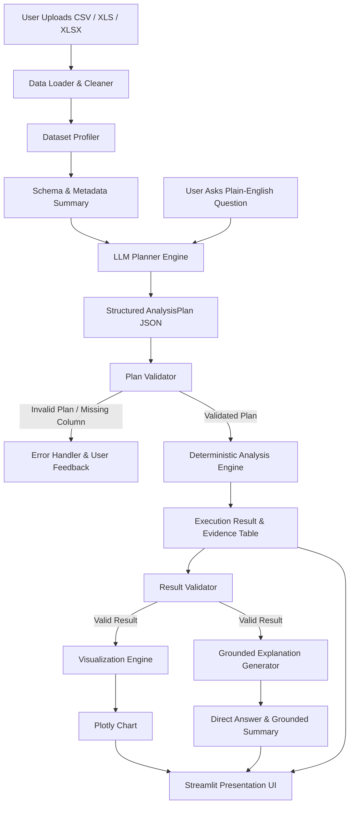

# Architecture & Design Document: Conversational Data Analysis Assistant (HCL P_123)

## 1. System Philosophy & Non-Negotiable Invariants
1. **Separation of Intent and Computation**: The Large Language Model (LLM) acts purely as an **Analysis Planner** and **Grounded Explainer**. It never performs arithmetic calculations or statistical aggregations directly.
2. **Zero Arbitrary Code Execution**: No `eval()`, `exec()`, or runtime Python script generation from LLMs. All analyses execute via deterministic, pre-tested Pandas/NumPy execution modules.
3. **Structured Plan Intermediate Representation (IR)**: The planner communicates with the execution engine exclusively through a strictly validated Pydantic JSON schema (`AnalysisPlan`).
4. **Rigid Pre-Execution Validation**: Every plan is validated against the dataset's live schema (column existence, type compatibility, valid aggregation methods, sensible filter thresholds) before any execution occurs.
5. **Deterministic Grounding**: The final answer's text is strictly bound to the computed DataFrame output. Hallucinated numbers or unverified statistics are strictly blocked.

---

## 2. End-to-End Dataflow Diagram



---

## 3. Directory Layout & Module Responsibilities

```
conversational-data-analyst/
├── app.py                          # Streamlit UI Entrypoint & Session State Manager
├── src/
│   ├── data/
│   │   ├── __init__.py
│   │   ├── loader.py               # Robust file loading (CSV, XLS via xlrd, XLSX via openpyxl)
│   │   ├── profiler.py             # Schema extraction, missingness, unique counts, type categorization
│   │   └── cleaner.py              # Non-destructive data cleaning (strip spaces, normalize dates/numbers)
│   ├── llm/
│   │   ├── __init__.py
│   │   ├── client.py               # Provider-agnostic LLM interface (Ollama / Gemini / Groq)
│   │   ├── planner.py              # Prompt construction, schema injection, JSON plan parsing
│   │   └── prompts.py              # System prompts, few-shot examples, JSON formatting instructions
│   ├── analysis/
│   │   ├── __init__.py
│   │   ├── schemas.py              # Pydantic models for AnalysisPlan, FilterCondition, ResultSummary
│   │   ├── validator.py            # Pre-execution schema verification & type checking
│   │   ├── executor.py             # Deterministic Pandas analysis engine (8 operations)
│   │   └── statistics.py           # Outlier detection, summary stats, correlation calculations
│   └── visualization/
│       ├── __init__.py
│       └── charts.py               # Dynamic Plotly chart generators (bar, line, scatter, box, pie)
├── datasets/
│   ├── demo/
│   │   └── sample_-_superstore.xls # Verified demo dataset (Orders, People, Returns sheets)
│   ├── validation/
│   │   ├── online_retail.xlsx      # E-commerce transaction benchmark
│   │   ├── online_shoppers.csv     # Web analytics benchmark
│   │   └── telco_churn.csv         # Customer churn benchmark
│   ├── synthetic/                  # Clean synthetic datasets for automated test suites
│   └── edge_cases/                 # Stress-test datasets (empty files, NaN columns, mixed types)
├── evaluation/
│   ├── benchmark_questions.json    # 50-100 tiered evaluation questions with ground truth
│   └── evaluate.py                 # Automated benchmark evaluator (accuracy & error classification)
├── tests/
│   ├── test_loader.py              # Unit tests for multi-format data ingestion
│   ├── test_profiler.py            # Unit tests for schema & type detection
│   ├── test_analysis.py            # Unit tests for 8 deterministic operations
│   ├── test_validator.py           # Unit tests for plan validation edge cases
│   └── test_planner.py             # Unit tests for LLM planning & JSON parsing
├── requirements.txt                # Pinned dependencies
├── README.md                       # Setup, usage guide, architecture overview
├── PROJECT_SPEC.md                 # Product specifications & milestones
├── ARCHITECTURE.md                 # System architecture (this document)
├── .env.example                    # Template for environment variables
└── .gitignore                      # Git ignore rules for virtual environments & secrets
```

---

## 4. Structured Analysis Plan IR (Pydantic Schema)

```python
from enum import Enum
from typing import List, Optional, Any, Union
from pydantic import BaseModel, Field

class OperationType(str, Enum):
    COUNT = "count"
    AGGREGATION = "aggregation"
    GROUPBY_AGGREGATE = "groupby_aggregate"
    TREND = "trend"
    CORRELATION = "correlation"
    OUTLIERS = "outliers"
    FILTER_PREVIEW = "filter_preview"
    UNSUPPORTED = "unsupported"

class AggregationType(str, Enum):
    SUM = "sum"
    MEAN = "mean"
    MEDIAN = "median"
    MIN = "min"
    MAX = "max"
    COUNT = "count"
    STD = "std"

class FilterOperator(str, Enum):
    EQUALS = "=="
    NOT_EQUALS = "!="
    GREATER_THAN = ">"
    GREATER_EQUAL = ">="
    LESS_THAN = "<"
    LESS_EQUAL = "<="
    IN = "in"
    NOT_IN = "not_in"
    CONTAINS = "contains"

class FilterCondition(BaseModel):
    column: str
    operator: FilterOperator
    value: Any

class ChartRecommendation(str, Enum):
    BAR = "bar"
    LINE = "line"
    SCATTER = "scatter"
    PIE = "pie"
    HISTOGRAM = "histogram"
    BOX = "box"
    NONE = "none"

class TimeGranularity(str, Enum):
    DAY = "D"
    WEEK = "W"
    MONTH = "ME"
    QUARTER = "QE"
    YEAR = "YE"

class AnalysisPlan(BaseModel):
    operation: OperationType
    target_column: Optional[str] = None
    target_columns: Optional[List[str]] = None
    group_by_columns: Optional[List[str]] = None
    aggregation: Optional[AggregationType] = None
    filters: Optional[List[FilterCondition]] = Field(default_factory=list)
    sort_ascending: Optional[bool] = None
    limit: Optional[int] = None
    date_column: Optional[str] = None
    time_granularity: Optional[TimeGranularity] = None
    chart: ChartRecommendation = ChartRecommendation.NONE
    unsupported_reason: Optional[str] = None
    explanation_focus: Optional[str] = None
```

---

## 5. Execution Pipeline & Error Handling Taxonomy

| Component | Error Class | Mitigation & Recovery |
|---|---|---|
| **Loader** | `InvalidFileError`, `UnsupportedFormatError` | Clean file type sniffing, graceful fallback between engines (`openpyxl` -> `xlrd` -> `calamine`). |
| **Profiler** | `EmptyDatasetError`, `AmbiguousDateError` | Return warnings, flag non-parseable columns as `object` without corrupting underlying data. |
| **Planner** | `MalformedJSONError`, `InvalidPlanSchemaError` | Strict JSON extraction from markdown fences, regex fallback, Pydantic validation error feedback loop. |
| **Validator** | `ColumnNotFoundError`, `IncompatibleDtypeError` | Exact & case-insensitive column matchers, suggestions for closest matching columns in schema. |
| **Executor** | `EmptyResultError`, `ZeroDivisionError` | Deterministic NaN/null handling, return structured empty state with user explanation. |
| **Visualizer** | `ChartRenderError` | Graceful fallback to raw tabular evidence if charting dimensions are malformed. |
| **Explainer** | `LLMTimeoutError`, `ContextOverflowError` | Deterministic template-based fallback summary when LLM explanation service is unavailable. |

---

## 6. Freeze on Phase 0 Scope
- **Included**: Local file inspections, architecture freeze, directory schema, Pydantic IR design, operational catalog, quality gates.
- **Explicitly Excluded from MVP**:
  - No vector databases / embeddings.
  - No autonomous multi-agent loops.
  - No background worker queues (Celery/Redis).
  - No user authentication / session databases.
  - No arbitrary Python script execution (`eval`/`exec`).
