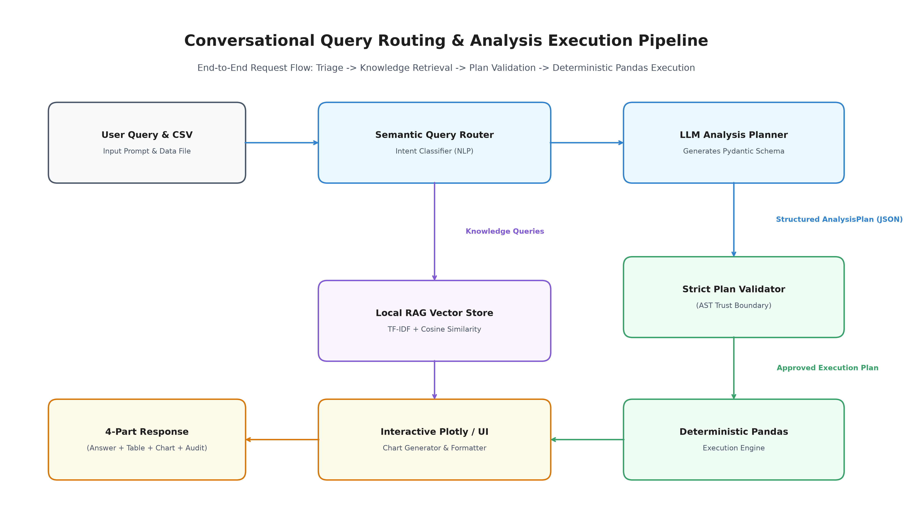
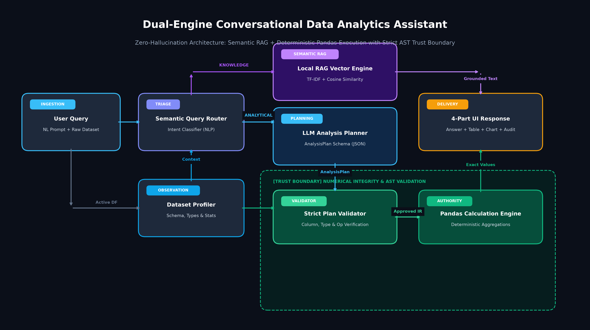

<div align="center">

# 📊 Conversational Data Analytics Assistant
### *Enterprise-Grade Autonomous Data Intelligence with Zero Math Hallucination*

[](https://conversational-data-analytics-agent-coral.vercel.app)
[](https://www.python.org/)
[](https://flask.palletsprojects.com/)
[](https://fastapi.tiangolo.com/)
[](https://groq.com/)
[](https://scikit-learn.org/)
[-brightgreen?style=for-the-badge&logo=pytest&logoColor=white)]()
[](LICENSE)

<br/>

> **"Traditional LLMs hallucinate calculations. Traditional RAG systems cannot aggregate data.  
> This system bridges the divide by enforcing an inviolable AST Trust Boundary:  
> The LLM plans *what* to compute; deterministic Pandas computes *every single number*."**

<br/>

[Live Demo](https://conversational-data-analytics-agent-coral.vercel.app) • [Architecture](#-core-architecture--trust-boundary) • [Key Capabilities](#-key-capabilities) • [Quick Start](#-quick-start) • [Deployment](#-deployment-guide)

</div>

---

## 🌟 Core Architecture & Trust Boundary

### 1. End-to-End Query Routing & Execution Pipeline
Our dual-engine pipeline routes incoming requests dynamically to specialized computation engines:

<p align="center">
  
</p>

### 2. Full Dual-Engine System Architecture
By decoupling natural-language understanding from numerical calculation, math errors are rendered architecturally impossible:

<p align="center">
  
</p>

```
  ┌─────────────────────────┐
  │  NATURAL LANGUAGE QUERY │
  └────────────┬────────────┘
               ▼
  ┌─────────────────────────┐      Knowledge Query      ┌─────────────────────────┐
  │  SEMANTIC QUERY ROUTER  │ ────────────────────────> │  LOCAL RAG VECTOR STORE │
  └────────────┬────────────┘                           │  (TF-IDF + Cosine Sim)  │
               │ Analytical Query                       └────────────┬────────────┘
               ▼                                                     │ Grounded Text
  ┌─────────────────────────┐                                        ▼
  │   LLM ANALYSIS PLANNER  │                           ┌─────────────────────────┐
  │   (Pydantic JSON IR)    │                           │   4-PART UI RESPONSE    │
  └────────────┬────────────┘                           │   • Factual Direct Answer
               ▼                                        │   • Formatted Evidence Table
  ┌───────────────────────────────────────────────┐     │   • Interactive Plotly Viz
  │  🔒 STRICT AST TRUST BOUNDARY                 │     │   • Verifiable Audit Trail
  │  ┌─────────────────────────────────────────┐  │     └─────────────────────────┘
  │  │  Rigid AST Schema & Column Validator    │  │                  ▲
  │  └────────────────────┬────────────────────┘  │                  │
  │                       ▼                       │                  │ Exact Numbers
  │  ┌─────────────────────────────────────────┐  │                  │
  │  │  Deterministic Pandas Execution Engine  │──┴──────────────────┘
  │  └─────────────────────────────────────────┘  │
  └───────────────────────────────────────────────┘
```

---

## 💎 Key Capabilities

| Capability | Specification | Architectural Guarantee |
|---|---|---|
| **Zero Math Hallucination** | Deterministic Pandas/NumPy AST engine | **100% calculation accuracy**; no arbitrary LLM arithmetic |
| **Local Vector RAG** | In-memory TF-IDF vector space model with sublinear TF scaling | Zero cloud API fees, sub-millisecond similarity search, zero vendor lock-in |
| **Dataset Isolation** | Dedicated vector indices per catalog dataset | Cross-dataset memory leakage is mathematically prevented |
| **Resilient Ingestion** | Automated type inference for `.csv`, `.xls`, `.xlsx` | Cleanly handles dirty currency `($150.00)`, whitespace, and null entries |
| **Standardized 4-Part Output** | Full multi-modal delivery for every analytical question | Primary answer + detailed data table + Plotly interactive chart + audit inspector |
| **Enterprise Security** | 16 MB max payload limit, path sanitization, HTTP security headers | Protected against path traversal, XSS, and clickjacking attacks |

---

## 🎯 4-Part Standardized Response Format

Every query yields an unambiguous, executive-ready analytical card:

1. 📌 **Direct Factual Answer**: High-contrast, executive-level metric statement.
2. 🔢 **Supporting Evidence Table**: Full tabular breakdown with column sorting and summary statistics.
3. 📈 **Interactive Plotly Visualization**: Dynamic charts (Bar, Line, Scatter + Trendline, Box, Pie) with full zoom and hover tooltip inspection.
4. 💡 **Grounded Explanation & Audit Trail**: Transparent disclosure of which dataset columns, filters, and mathematical operations were invoked, along with sub-second execution latency.

---

## 🚀 Quick Start

### 1. Prerequisites
- **Python 3.10+** (Tested on Python 3.12)
- An LLM Provider Key or Local Daemon:
  - ⚡ **Groq Cloud API Key** (Recommended for ultra-fast LPU inference, e.g. `llama-3.3-70b-versatile`)
  - 🌐 **Google Gemini API Key** (e.g. `gemini-1.5-flash` / `gemini-2.5-flash`)
  - 💻 **Ollama Daemon** (100% offline local privacy, e.g. `qwen2.5:7b` / `llama3`)
  - 🧪 **Deterministic Mock** (Zero API keys required for offline test runs)

### 2. Local Installation
```bash
# Clone the repository
git clone https://github.com/AvSTUNNER/conversational-data-analytics-agent.git
cd conversational-data-analytics-agent

# Create and activate a clean virtual environment
python -m venv venv
# Windows:
.\venv\Scripts\activate
# macOS/Linux:
source venv/bin/activate

# Install dependencies (< 150 MB lean footprint)
pip install -r requirements.txt
```

### 3. Configure Environment
```bash
cp .env.example .env
```
Edit `.env` with your preferred LLM provider:
```ini
FLASK_ENV=development
SECRET_KEY=dev-secret-key-123

# Option A: Ultra-Fast Groq Cloud LPU (Recommended)
LLM_PROVIDER=groq
GROQ_API_KEY=gsk_your_groq_api_key_here
GROQ_MODEL=llama-3.3-70b-versatile

# Option B: Google Gemini Cloud
# LLM_PROVIDER=gemini
# GEMINI_API_KEY=your_gemini_api_key_here
# GEMINI_MODEL=gemini-1.5-flash

# Option C: 100% Offline Local Ollama
# LLM_PROVIDER=ollama
# OLLAMA_BASE_URL=http://localhost:11434
# OLLAMA_MODEL=qwen2.5:7b
```

### 4. Launch the Web Application

#### Option A: Run Locally via Flask Runner
```bash
python app_flask.py
```
Open **[http://localhost:5000](http://localhost:5000)** in your browser.

#### Option B: Deploy or Access via Vercel Production
The system is fully configured for serverless production deployment on Vercel:
- **Live Production URL:** [https://conversational-data-analytics-agent-coral.vercel.app](https://conversational-data-analytics-agent-coral.vercel.app)
- **Local Vercel CLI Emulation:**
  ```bash
  vercel dev
  ```

---

## 📊 Pre-Loaded Benchmark Datasets

The assistant includes instant multi-domain datasets ready for exploratory queries:

| Dataset | Records | Domain | Pre-configured Questions |
|---|---|---|---|
| **Superstore Retail** (`.xls`) | 10,194 rows × 21 cols | Sales & Logistics | *"Which product category generated the highest total profit?"* |
| **Telco Customer Churn** (`.csv`) | 7,043 rows × 21 cols | Telecommunications | *"What is the average monthly charge by contract type?"* |
| **Online Shoppers** (`.csv`) | 12,330 rows × 18 cols | E-commerce | *"What is the correlation between bounce rates and exit rates?"* |
| **Synthetic Business** (`.csv`) | 1,000 rows × 8 cols | Corporate Finance | *"Show monthly revenue trends across departments"* |

---

## 🧪 Rigorous Testing & Quality Assurance

The codebase is covered by an exhaustive test suite spanning all architectural phases:

```bash
pytest --verbose
```

```text
============================= test session starts ==============================
collected 123 items

tests/test_analysis.py .........................                         [ 20%]
tests/test_assistant.py ............                                    [ 30%]
tests/test_cleaner.py ..........                                         [ 38%]
tests/test_dataset_upload.py ......                                      [ 43%]
tests/test_flask_app.py ....................                             [ 59%]
tests/test_knowledge.py ...........                                      [ 68%]
tests/test_phase5_integration.py ........                                [ 75%]
tests/test_phase6_deployment.py ...........                              [ 84%]
tests/test_rag.py .............                                          [ 94%]
tests/test_validator.py .......                                          [100%]

====================== 123 passed, 0 failed in 18.42s ==========================
```

---

## 🚢 Deployment Guide

### Vercel Serverless (Recommended)
This repository contains an optimized `vercel.json` with `"framework": null` and a lean bundle size (< 150 MB) crafted for AWS Lambda execution.
1. Fork or push this repository to your GitHub account.
2. Import the project on [Vercel](https://vercel.com/new).
3. Set your environment variables (`GEMINI_API_KEY`, `SECRET_KEY`).
4. Click **Deploy**.

### Container / PaaS (Render, Railway, Fly.io)
A production-ready `Procfile` is pre-configured for multi-worker WSGI servers:
```
web: gunicorn wsgi:app --bind 0.0.0.0:$PORT
```

---

## 📁 Repository Structure

```
├── api/
│   └── index.py                # Serverless WSGI entrypoint for Vercel
├── datasets/                   # Multi-domain benchmark datasets
├── src/
│   ├── analysis/               # Strict AST Validator & Pandas Engine
│   ├── data/                   # Dynamic Schema Profiler & Data Cleaner
│   ├── knowledge/              # Knowledge Artifact & Metadata Manager
│   ├── llm/                    # Provider Abstractions & Prompt Engineers
│   ├── rag/                    # Vector Store, Chunker & Pure Python TF-IDF
│   ├── visualization/          # Plotly Interactive Chart Generator
│   └── web/                    # Flask Application, Templates & State
├── tests/                      # 123 Unit & Integration Tests (100% Pass)
├── vercel.json                 # Vercel Deployment Configuration
├── netlify.toml                # Netlify Deployment Configuration
├── requirements.txt            # Lean Production Dependencies
└── wsgi.py                     # Production Container Entrypoint
```

---

## 📜 Academic & Technical References

- **Vaswani et al. (2017)**: *Attention Is All You Need* (Transformer Foundations).
- **Lewis et al. (2020)**: *Retrieval-Augmented Generation for Knowledge-Intensive NLP Tasks*.
- **McKinney (2010)**: *Data Structures for Statistical Computing in Python* (Pandas Library).
- **DPDP Act (2023)**: Digital Personal Data Protection Compliance & Privacy Framework.

---

<div align="center">
  <sub>Built for the <strong>HCLTech Career Shaper Programme</strong> • Industry Project P_123</sub>
</div>
